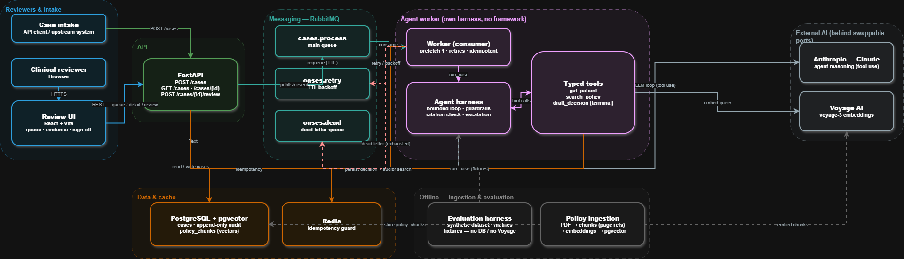

# Health Operations Agent — Prior-Authorization Assistant

An autonomous agent that drafts prior-authorization decisions, with its own agent
harness, typed tools, an evaluation system, retry/dead-letter reliability, and a
human review console. Every clinical claim is backed by a cited policy passage, and
denials and low-confidence cases are always routed to a human.

> **Status:** engineering demo, not a production system. **Synthetic data only —
> zero real PHI.**

---

## The problem

Prior authorization is a slow, manual, error-prone gate in healthcare: a clinician's
request is checked, criterion by criterion, against a payer's policy. The work is
repetitive but high-stakes — a wrong approval or denial has real consequences.

This agent assists that review. Given a synthetic FHIR patient, clinical notes, and a
payer policy (PDF), it:

1. Extracts the relevant clinical data (`get_patient`).
2. Retrieves the applicable policy criteria by meaning, not keywords (`search_policy`).
3. Evaluates each criterion, **citing the exact policy passage** it relies on.
4. Drafts a decision packet — **approve / deny / request more information**.
5. **Escalates to a human reviewer** when it would deny or is not confident.

The agent never finalizes a denial or a low-confidence case on its own — a human does.

---

## Architecture



> The editable source is [`docs/architecture.drawio`](docs/architecture.drawio)
> (open with [diagrams.net](https://app.diagrams.net)).

| Layer | What it does |
|---|---|
| **Review UI** (`web/`) | React + Vite console: the queue of escalated cases, each decision with its cited evidence, and approve / deny / request-info sign-off. |
| **API** (`app/api`) | FastAPI. Accepts and queries cases, lists the review queue, records the human decision. Thin — it enqueues work, never runs the agent inline. |
| **Messaging** (`app/messaging`) | RabbitMQ with a retry/dead-letter topology — failures are retried with backoff, then dead-lettered, never dropped. |
| **Agent worker** (`app/agent`, `app/workers`) | A custom agent loop (no framework) with typed tools, hard limits, and guardrails enforced in code. |
| **Data & cache** (`app/db`) | PostgreSQL + pgvector (cases, append-only audit, policy vectors) and Redis (idempotency). |
| **External AI** (`app/llm`, `app/ingestion`) | Anthropic Claude for reasoning and Voyage for embeddings — both behind swappable interfaces. |
| **Offline** (`evals/`, `app/ingestion`) | Policy ingestion and the evaluation harness (fixtures — runs with no database or embedding API). |

---

## Engineering decisions that matter

The decisions below are what separate this from an "LLM wrapper." Each is recorded as
an ADR in [`docs/adr/`](docs/adr).

- **A custom agent loop, not a framework** ([ADR 002](docs/adr/002-custom-agent-loop.md)).
  Owning the loop makes the limits (max steps / timeout / token budget), tool
  selection, and guardrails fully testable and observable — and makes the evals
  precise.
- **Citation faithfulness is enforced in code, not prompted.** Every claim must cite a
  passage the agent actually retrieved; the guardrail cross-checks each citation
  against the retrieved set and discards fabricated ones, downgrading the verdict to
  "cannot determine." The evals **measure** this — on the real baseline it holds at
  1.000.
- **Ports and adapters throughout.** The LLM, the embedder, and the policy store sit
  behind interfaces. That is why the evaluation harness can run the real agent with
  **zero** calls to the database or the embedding API — it swaps in fixtures.
- **An evaluation system, not vibes** ([ADR 004](docs/adr/004-eval-ci-gating.md)). A
  versioned dataset of synthetic cases with known answers, deterministic metrics, a
  CI self-check gate, and a committed baseline report.
- **Reliability is designed, not hoped for.** Retry-with-backoff and a dead-letter
  queue mean every request is accounted for; reprocessing is idempotent.

---

## Results

Baseline against `claude-haiku-4-5` on the 6 public evaluation cases
([full report](docs/eval-report.md)):

| Metric | Value |
|---|---|
| Decision accuracy | 0.833 |
| Escalation accuracy | 0.833 |
| **Citation faithfulness** | **1.000** |
| Per-criterion accuracy | 0.923 |
| Unsupported claims | 0 |

The headline is **citation faithfulness 1.000 / 0 unsupported claims**: against a real
model, the agent never cited evidence it hadn't retrieved — the in-code guardrail holds.

The one decision "miss" is the honest kind an eval exists to surface: on a genuinely
ambiguous policy, the agent chose `request_info` where the expected label was a
low-confidence approval. Reviewing it, the agent's choice was arguably the more
defensible one — the label was kept rather than tuned to the model.

---

## Stack

Python 3.12 · FastAPI + Pydantic v2 · Anthropic API (behind a swappable `LLMClient`) ·
custom agent loop · PostgreSQL + pgvector · SQLAlchemy 2 async + Alembic · RabbitMQ ·
Redis · Voyage embeddings · PyMuPDF · `pytest` evals · React + Vite + TypeScript ·
Docker Compose · GitHub Actions · `ruff` / `mypy` (strict).

---

## Run it

```bash
cp .env.example .env          # set ANTHROPIC_API_KEY and VOYAGE_API_KEY
pip install -e ".[dev]"
ruff check . && mypy app evals scripts && pytest   # the CI gate
```

### The full slice

`docker compose up` applies migrations, then brings up the API, the agent worker, the
review UI, Postgres (pgvector), RabbitMQ, and Redis.

```bash
python data/make_sample_policy.py    # a synthetic policy matching the patient fixture
docker compose up -d --build

# ingest the policy (inside the worker — it has the DB + data volume)
docker compose exec worker \
  python -m app.ingestion.ingest_cli data/policies/sample-policy.pdf sample-policy policy-doc-1

# submit a synthetic case; poll for the cited decision
curl -X POST localhost:8000/cases -H 'content-type: application/json' \
  -d '{"idempotency_key":"demo-1","policy_id":"sample-policy","patient_ref":"patient-001"}'
curl localhost:8000/cases/<case_id>
```

## Evaluation

The agent is scored against a versioned dataset of synthetic cases (`evals/cases/`) on
decision accuracy, citation faithfulness, correct escalation, and per-criterion
accuracy — with no database or embedding API (fixtures). See
[`docs/eval-report.md`](docs/eval-report.md) for the baseline.

```bash
python evals/run_evals.py --self-check                        # deterministic; the CI gate
python evals/run_evals.py --model claude-haiku-4-5 --report   # real metrics + report
```

## Reliability

When the worker fails on a case (a transient LLM/API error, a DB hiccup), the message
is retried with a delay through a dead-letter topology, up to 3 attempts; after that
the case is marked `failed` (with a redacted `last_error`) and its message lands in a
durable `cases.dead` queue for inspection. An un-parseable message is dead-lettered on
first delivery. Because `cases.process` carries dead-letter arguments, upgrading an
older broker needs a recreate (`docker compose down` then `up`).

## Review UI

A reviewer console (`web/`, React + Vite + TypeScript) for the escalated cases. It
shows each drafted decision with its **cited policy evidence** — every criterion paired
with the exact passage it rests on — and lets a reviewer approve, deny, or request more
information. With the stack up it is served at **http://localhost:5173**; to run it on
the host, `cd web && npm install && npm run dev`.

---

## Compliance & limitations

- **Synthetic data only.** No real PHI anywhere — not in code, fixtures, logs, or while
  debugging. Sensitive fields are redacted in the audit log.
- **For a real production deployment** you would additionally need: a BAA with the LLM
  provider, encryption at rest and in transit, role-based access control, data
  retention/deletion policies, and full audit logging. (Colombia analogy: Law 1581 /
  habeas data.)
- **Known limits:** reviewer identity is a stub (no auth/RBAC yet); the eval dataset is
  small (8 cases, growing); the dead-letter cycle and the UI click-through are verified
  manually against a live stack, not in CI.

## License

TBD.
